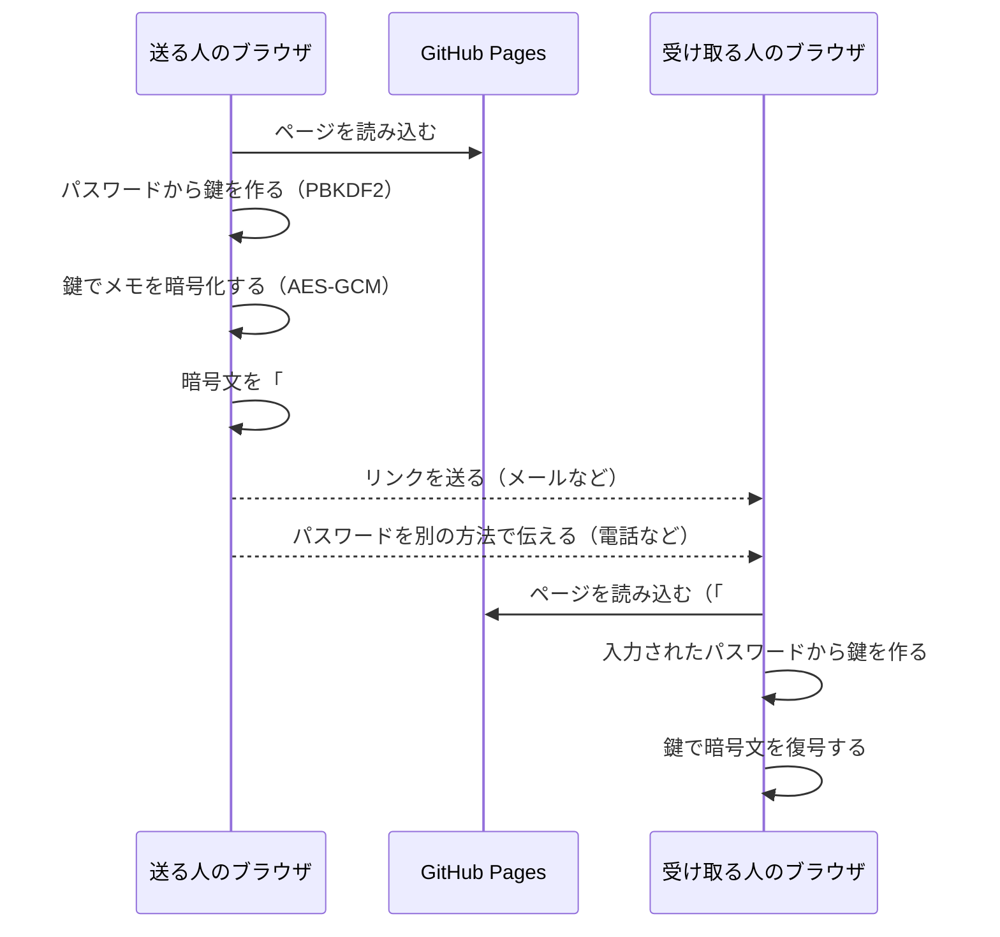

# ひみつリンク

パスワードを知っている人だけが読めるメモを、リンクで渡せる Web サイトです。
メモはブラウザの中で暗号化され、**メモもパスワードも、どのサーバーにも送信・保存されません**。

- デモ：https://yamasho0419.github.io/secret-link/
- 使用技術：TypeScript、Web Crypto API、Vite、Vitest、GitHub Pages

## 使い方

1. メモとパスワードを入力し、「暗号化してリンクを作る」を押す
2. できたリンク（または QR コード）を相手に送る
3. パスワードは、リンクとは**別の方法**で相手に伝える（リンクはメール、パスワードは電話など）
4. 相手がリンクを開いてパスワードを入力すると、メモが表示される

パスワードが違う場合と、リンクが途中で書き換えられた場合は、どちらも開けません。

## なぜ作ったか

Wi-Fi のパスワードや口座番号のような人に知られたくない情報を、チャットにそのまま貼ると、その文字列はサービスの運営会社のサーバーやトーク履歴に残り続けます。
「パスワードを知っている本人だけが読める」状態を、サーバーを信用しなくても作れるかを確かめるために作りました。

## 仕組み



### ポイント1：暗号文は「#」の後ろに入れる

リンクはこのような形になります。

```
https://yamasho0419.github.io/secret-link/#m=AQx7...（暗号文）
```

ブラウザは、URL の `#` より後ろの部分をサーバーに送りません。
そのため、配信している GitHub Pages のサーバーも暗号文を受け取らず、記録も残りません。
このサイトにはデータを保存するサーバーがなく、メモは**リンクそのものの中**にあります。

### ポイント2：パスワードから鍵を作る

パスワードをそのまま鍵には使わず、PBKDF2 という方式で 60万回計算を重ねて鍵を作ります。
1回の計算に時間がかかるため、パスワードを片っ端から試す攻撃（総当たり）を遅くできます。

計算にはソルト（毎回ランダムに作る16バイトの値）を混ぜます。
同じパスワードでもメモごとに違う鍵になるので、「よく使われるパスワードの鍵の一覧」を事前に作っておく攻撃が使えません。

### ポイント3：暗号化と改ざん検知を同時に行う

AES-GCM という方式で暗号化します。
AES-GCM は暗号文に改ざん検知用のタグを付けるので、リンクの文字が1つでも書き換えられると復号に失敗します。
間違った内容が表示されることはなく、「開けない」という結果になります。

### リンクの中身

```
[バージョン 1バイト][ソルト 16バイト][IV 12バイト][暗号化されたメモ][改ざん検知用タグ 16バイト]
```

これを URL に使える文字（base64url）に変換して `#m=` の後ろに入れます。
バージョンは暗号化されませんが、改ざん検知の対象に含めているので、書き換えると復号に失敗します。

## 想定した脅威と対策

| 脅威 | 対策 | 実装箇所 |
|---|---|---|
| サーバーの運営者や、サーバーへの侵入者にメモを読まれる | 暗号化と復号をブラウザの中だけで行い、メモもパスワードもサーバーに送らない。暗号文は `#` の後ろに置き、サーバーに届かないようにする | `src/crypto.ts`, `src/main.ts` |
| リンクを盗み見た人にメモを読まれる | パスワードがなければ復号できない。パスワードはリンクと別の方法で伝えるよう画面で案内する | `index.html` |
| パスワードの総当たり | PBKDF2 を 60万回繰り返し、1回の試行を遅くする（OWASP の推奨値）。パスワードの自動生成機能で、推測されにくい20文字を作れる | `deriveKey`, `generatePassword` |
| 事前に計算した表を使った攻撃 | メモごとにランダムなソルトを使う | `encryptMemo` |
| リンクの改ざん（内容のすり替え） | AES-GCM の改ざん検知で、1ビットの変更でも復号を失敗させる | `decryptMemo` |
| 同じメモから同じ暗号文ができ、内容が推測される | ソルトと IV を毎回ランダムに作るので、同じメモとパスワードでも毎回違う暗号文になる | `encryptMemo` |
| 失敗の理由から情報を引き出される | パスワード違い・改ざん・形式の誤りを区別せず、同じメッセージを返す | `DecryptError` |
| メモに書かれた HTML やスクリプトの実行（XSS） | メモは `textContent` で表示し、HTML として解釈させない。さらに Content-Security-Policy で、同じサイトのスクリプト以外の実行と、外部への通信を禁止する | `src/main.ts`, `index.html` |
| リンクが別サイトに漏れる | `referrer` を送らない設定にする | `index.html` |

### 暗号処理を自作しない

暗号のアルゴリズムは、ブラウザ標準の Web Crypto API に任せています。
自分で書いたのは「どの方式を、どの設定で、どう組み合わせるか」と「データの並べ方」だけです。

## このサイトで守れないもの

- **パスワードが弱い場合**：短いパスワードや推測しやすいパスワードは、時間をかければ総当たりで破られます。リンクは何度でも試せるので、試行回数の制限もできません。
- **パスワードを同じ場所で伝えた場合**：リンクとパスワードを同じメールに書くと、暗号化の意味がなくなります。
- **リンクの有効期限・取り消し**：リンクの中にメモがあるため、一度送ったリンクを無効にできません。
- **端末そのものが乗っ取られている場合**：ブラウザの画面やキー入力を盗み見られると守れません。
- **配信元が改ざんされた場合**：GitHub Pages のファイルが書き換えられると、暗号化前のメモを送信するスクリプトにすり替えられる可能性があります。この点は配信元を信頼しています。

## ファイル構成

```
index.html            画面と Content-Security-Policy
src/crypto.ts         暗号化・復号・パスワード生成
src/crypto.test.ts    テスト
src/main.ts           画面の動き
src/style.css         見た目
.github/workflows/    テストと GitHub Pages への公開
```

## 動かし方

必要なもの：Node.js 22 以降

```sh
npm install
npm run dev     # http://localhost:5173 で開く
npm test        # テストを実行する
npm run build   # dist/ に公開用のファイルを作る
```

暗号機能は `https://` か `localhost` で開いたときだけ使えます。

### テストで確かめていること

- 正しいパスワードなら元のメモに戻る（日本語・絵文字・改行・空のメモを含む）
- パスワードが違うと復号できない
- 同じメモとパスワードでも、暗号文が毎回変わる
- バージョン・ソルト・IV・暗号文・タグの**どこを1ビット書き換えても**復号できない
- 形式が正しくないデータを拒否する
- 全角で入力したパスワードでも、半角と同じように開ける（スマホとパソコンの入力の違い対策）
- 自動生成するパスワードの長さと、使う文字

## 公開の仕組み

`main` ブランチに push すると、GitHub Actions がテストを実行し、合格した場合だけ GitHub Pages に公開します。
